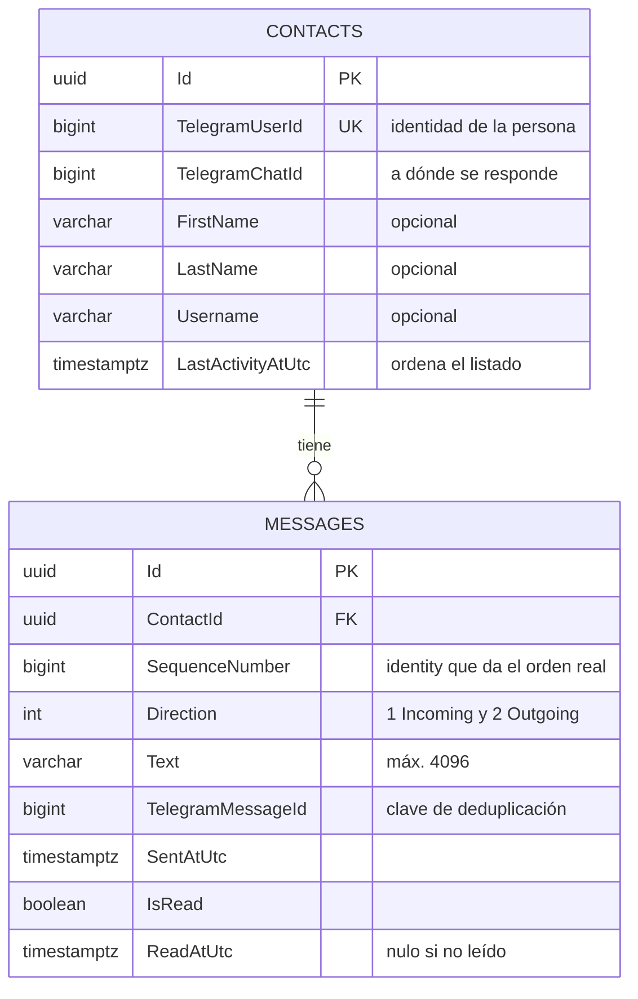

# Arquitectura

Complementa los diagramas C4 de esta carpeta. Su objetivo es que **cada caja de los diagramas se
pueda rastrear hasta el código**, y dejar explícitos el esquema de datos, las garantías de entrega y
los modos de falla.

No repite el README (cómo levantar y probar la solución) ni los ADRs (por qué se eligió cada
tecnología). Es el puente entre ambos.

| Dónde mirar | Qué contiene |
|---|---|
| [`c4-context.svg`](c4-context.svg) | Nivel 1: el sistema, el operador y los servicios externos |
| [`c4-containers.svg`](c4-containers.svg) | Nivel 2: los cinco contenedores de Compose |
| Este documento | Trazabilidad C4 ↔ código, esquema de datos, garantías, modos de falla |
| [`../adr/`](../adr/) | Las cuatro decisiones y sus alternativas descartadas |
| [`../validation-checklist.md`](../validation-checklist.md) | Qué se verificó y con qué evidencia |

---

## 1. Del diagrama al código

Los cinco contenedores del nivel 2 corresponden a los cinco servicios de `docker-compose.yml`. El
único escrito en este repositorio es `api`; los otros cuatro son imágenes oficiales o el frontend
servido por nginx.

| Contenedor C4 | Servicio Compose | Implementación |
|---|---|---|
| Bandeja web | `frontend` | [`src/frontend/`](../../src/frontend/), servida por nginx con proxy de `/api` y `/hubs` |
| API + webhook + tiempo real | `api` | [`src/backend/EncodeLabs.Api/`](../../src/backend/EncodeLabs.Api/) |
| Broker de mensajes | `rabbitmq` | `rabbitmq:4-management-alpine` |
| Base de datos | `postgres` | `postgres:18-alpine` |
| Túnel público | `ngrok` | `ngrok/ngrok:3`, apunta al puerto de la **API**, no del frontend |

Dentro de `api` conviven tres responsabilidades que podrían haber sido procesos separados. ADR-004
explica por qué no lo son:

| Responsabilidad | Punto de entrada |
|---|---|
| Webhook de Telegram | [`TelegramWebhookEndpoints.cs`](../../src/backend/EncodeLabs.Api/Endpoints/TelegramWebhookEndpoints.cs) |
| API de la bandeja | [`InboxEndpoints.cs`](../../src/backend/EncodeLabs.Api/Endpoints/InboxEndpoints.cs) |
| Hub de tiempo real | [`InboxHub.cs`](../../src/backend/EncodeLabs.Api/Realtime/InboxHub.cs) |
| Consumidor de la cola | [`IncomingTelegramMessageConsumerService.cs`](../../src/backend/EncodeLabs.Infrastructure/Messaging/RabbitMq/IncomingTelegramMessageConsumerService.cs) |
| Registro del webhook al arrancar | [`TelegramWebhookRegistrationService.cs`](../../src/backend/EncodeLabs.Api/BackgroundServices/TelegramWebhookRegistrationService.cs) |

---

## 2. Separación de responsabilidades

Cuatro proyectos, con las dependencias apuntando siempre hacia adentro.

```
EncodeLabs.Api ──┐
                 ├──> EncodeLabs.Application ──> EncodeLabs.Domain
EncodeLabs.Infrastructure ──┘
```

| Proyecto | Contiene | Depende de |
|---|---|---|
| `Domain` | `Contact`, `Message`, `MessageText`, `MessageDirection` y sus reglas | **Nada** |
| `Application` | Casos de uso y los puertos que necesitan | `Domain` |
| `Infrastructure` | EF Core, RabbitMQ, Bot API, ngrok | `Application`, `Domain` |
| `Api` | Transporte HTTP, SignalR, composición | Todos |

**Cómo verificarlo en 10 segundos:** abrir
[`EncodeLabs.Domain.csproj`](../../src/backend/EncodeLabs.Domain/EncodeLabs.Domain.csproj). No tiene
ni una `PackageReference`. Meter EF Core o un atributo de serialización en una entidad exigiría
agregar el paquete, y la violación quedaría visible en el diff.

### El desacople, concretamente

`Application` declara lo que el caso de uso necesita; `Infrastructure` lo implementa.

| Puerto (en `Application`) | Implementación (en `Infrastructure` o `Api`) |
|---|---|
| `IIncomingMessageQueuePublisher` | `RabbitMqIncomingMessagePublisher` |
| `ITelegramReplySender` | `TelegramBotApiClient` |
| `IInboxRealtimeNotifier` | `SignalRInboxRealtimeNotifier` |
| `IPublicTunnelUrlProvider` | `NgrokTunnelUrlProvider` |
| `IContactRepository`, `IMessageRepository`, `IUnitOfWork` | Repositorios sobre EF Core |

`ProcessIncomingTelegramMessageHandler` no conoce RabbitMQ ni SignalR: conoce dos interfaces. Esa es
la razón por la que las reglas del estado de leído se prueban con 25 tests unitarios que no
necesitan base de datos ni broker.

---

## 3. Esquema de base de datos

PostgreSQL 18, creado por la migración `InitialInboxSchema` al arrancar. ADR-001 justifica la
elección del motor.



**No hay entidad `Conversation`.** En un chat privado de Telegram, un contacto *es* una conversación:
la tabla tendría una fila por contacto y ninguna columna propia.

### Por qué cada índice existe

| Índice | Consulta que sirve |
|---|---|
| `(ContactId, TelegramMessageId)` **único** | Garantía dura de deduplicación: la base rechaza el duplicado aunque dos consumidores corran a la vez |
| `(ContactId, SequenceNumber)` | Historial ordenado y marcado por corte |
| `(ContactId, Direction, IsRead)` | Conteo de no leídos del listado |

### Tres decisiones del esquema que vale señalar

1. **`SequenceNumber` es `bigint GENERATED BY DEFAULT AS IDENTITY`**, no un timestamp. PostgreSQL
   asigna un valor monotónico en el orden real de inserción, sin empates. Es lo que hace posible el
   marcado como leído sin carreras (sección 4). No es un `uuid` porque lo que hace falta acá es
   **orden, no unicidad** —de identificar la fila ya se encarga `Id uuid`— y `<= N` no tiene
   equivalente sobre un identificador sin orden. Es `bigint` y no `int` porque agotar un entero de
   32 bits en mensajería es alcanzable, y esa falla no degrada: detiene toda inserción.
2. **`MessageDirection` arranca en 1**, no en 0. Así un valor por defecto nunca es una dirección
   válida y un error de mapeo falla en vez de pasar desapercibido.
3. **`TelegramUserId` y `TelegramChatId` se guardan por separado** aunque en chats privados
   coincidan. Son conceptos distintos y asumir que son el mismo sería una suposición frágil. Ambos
   son `bigint` porque lo exige el contrato de Telegram, que documenta sus identificadores como
   valores de más de 32 bits significativos: con `int` desbordarían.

---

## 4. Las garantías del sistema

Lo que el sistema promete, y el mecanismo que sostiene cada promesa.

| Garantía | Mecanismo |
|---|---|
| Ningún mensaje entrante se pierde | El webhook responde `2xx` **sólo** tras la confirmación del broker; si no, `503` y Telegram reintenta |
| Un mensaje repetido no se duplica | Índice único `(ContactId, TelegramMessageId)`, con un `SELECT` previo para el camino normal |
| Un mensaje envenenado no bloquea la cola | 3 reintentos y `BasicNackAsync(requeue: false)` → cola de descarte |
| No se marca como leído lo que el operador no vio | Corte por `SequenceNumber` enviado desde el cliente |
| No se muestra como enviado lo que Telegram rechazó | La fila se escribe **después** del ACK de Telegram |
| El cliente no se queda con estado viejo | Al conectar y en cada reconexión, refetch completo en vez de confiar en memoria |

**Entrega *at-least-once*, no *exactly-once*.** Es deliberado: el ACK manual ocurre después del
commit, así que una caída a mitad de camino produce una redelivery. La deduplicación la absorbe.

### Para qué volumen está diseñado

Declararlo importa: sin un sobre de carga, "esto escala" es una opinión. Las decisiones de este
diseño apuntan a **un equipo de atención, no a una plataforma multiinquilino**:

| Dimensión | Objetivo de diseño | Qué lo limita |
|---|---|---|
| Operadores simultáneos | decenas | Una sola instancia de API; sin backplane de SignalR |
| Mensajes entrantes | del orden de cientos por minuto | `prefetch 10` y despacho secuencial en el consumidor |
| Conversaciones abiertas | del orden de cientos | Sub-consultas correlacionadas en el listado de contactos |
| Latencia del webhook | decenas de milisegundos | Medido: 43 ms y 104 ms con bot real, incluida la confirmación del broker |

**El primer techo que se va a tocar es el listado de contactos**, no la ingesta: resuelve el contador
de no leídos y la vista previa con una sub-consulta correlacionada por contacto. La salida está en
la sección 6, y es desnormalizar el contador, no cachearlo.

Fuera de ese sobre el diseño no se rompe, pero deja de ser el adecuado: a partir de ahí aplican los
pasos de la ruta de escalado.

### El marcado como leído, en detalle

Es el punto del enunciado con una carrera real. El `UPDATE ... WHERE is_read = false` ingenuo marca
también los mensajes que llegan *durante* la operación, que el operador nunca vio. Acotar por
timestamp no alcanza: Telegram tiene resolución de un segundo y puede haber empates.

El protocolo implementado:

1. `GET /api/contacts/{id}/messages` devuelve los mensajes **y** su `highestSequenceNumber`.
2. El cliente envía ese número como `readUpToSequenceNumber`.
3. El servidor marca sólo los entrantes no leídos con `SequenceNumber <= corte`.

Un mensaje que llega durante la operación recibe un número mayor y queda fuera **por construcción**.
El cliente no dice "marcá todo": dice "vi hasta acá".

---

## 5. Modos de falla

Cada fila fue **ejercitada**, no razonada. La evidencia completa está en
[`../code-review.md`](../code-review.md).

| Falla | Qué ve el operador | Qué pasa con los datos | Recuperación |
|---|---|---|---|
| RabbitMQ caído | La bandeja sigue respondiendo | El webhook devuelve `503`; Telegram reintenta la misma entrega | Automática al volver el broker. Verificado: 7 × `503` con el mismo `update_id`, luego `202` |
| PostgreSQL caído | Errores en la bandeja | 3 reintentos y el mensaje va a la cola de descarte con el payload íntegro | **Manual.** Ver riesgo abierto abajo |
| API reiniciada | "Reconectando…" y vuelve a "En línea" | Nada se pierde: los mensajes esperan en la cola | Automática, con refetch al reconectar |
| URL de ngrok nueva | Transparente | — | Automática: la API descubre la URL y re-registra el webhook |
| Bot bloqueado por el usuario | `Telegram rechazó la respuesta: Forbidden…` | No se escribe fila | Requiere acción del contacto |
| Bot API inalcanzable | "No se pudo contactar a Telegram" | No se escribe fila | Reintentar sirve (`504`, distinto de `502`) |

### El riesgo abierto que conviene conocer

Un mensaje que agota los tres reintentos **no llega a la bandeja**: queda en la cola de descarte y
Telegram ya no lo reintenta, porque el webhook respondió `202` al encolarlo. El payload queda íntegro
y recuperable, pero el reproceso es manual.

Es una decisión consciente: reencolar haría que un mensaje permanentemente fallido entre en bucle y
bloquee la cola. En producción esto se acompañaría de una alerta sobre la profundidad de esa cola; no
se agregó observabilidad porque está fuera del alcance del enunciado.

---

## 6. Qué se dejó afuera, y por qué

Fuera de alcance por el enunciado: autenticación, multimedia, diseño responsive y paginación.
Decisiones propias:

| Omisión | Razón |
|---|---|
| MediatR / CQRS | Los casos de uso son clases inyectadas directo. MediatR agregaría indirección sin corregir nada |
| Redis | Nada necesita caché compartida. Entraría como backplane de SignalR recién con varias instancias |
| Worker desplegable aparte | El consumidor necesita empujar por SignalR tras persistir; separarlo exigiría un backplane sólo para que dos procesos se hablen (ADR-004) |
| Caché de contadores | Un contador de no leídos desactualizado erosiona la confianza del operador más de lo que la caché mejora la latencia |
| Entidad `Conversation` | Un contacto es una conversación en Telegram privado |

### Estrategia de tests

El enunciado los pide opcionales y, si se incluyen, unitarios sobre el dominio. Hay **25 tests**
(`tests/EncodeLabs.Domain.UnitTests`, xUnit v3) concentrados donde el dominio **decide**: un entrante
nace no leído y un saliente nace leído, `MarkAsRead` es idempotente y se rechaza sobre un saliente,
el límite de 4096 caracteres de Telegram en sus dos bordes, los cuatro niveles de respaldo de
`DisplayName`, y que `RegisterActivity` ignore un timestamp más viejo para que una entrega fuera de
orden no reordene la bandeja. Corren sin base ni broker porque el dominio no los conoce: eso es el
desacople de la sección 2 siendo útil, no sólo prolijo.

**No hay tests de integración, y es deliberado.** Las garantías más importantes del sistema no viven
en código propio sino en la infraestructura: la deduplicación la garantiza un índice único de
PostgreSQL, la no-pérdida la garantizan los *publisher confirms* y el ACK manual de RabbitMQ. Un test
con un proveedor en memoria no ejercita ninguna de las dos —probaría el doble, no la garantía— y
dejaría una luz verde que no significa nada. Esas propiedades se verificaron **contra la
infraestructura real**, apagando el broker y la base con mensajes en vuelo; la evidencia está en
[validation-checklist.md](../validation-checklist.md).

Una nota de herramientas: los tests se corren con `dotnet run --project`, no con `dotnet test`. Son
ejecutables auto-hospedados sobre Microsoft.Testing.Platform y el runner de `dotnet test` falla en
este SDK; el diagnóstico completo está en CR-002 de [code-review.md](../code-review.md).

### Ruta de escalado, en orden

1. Listado lento → desnormalizar el contador de no leídos a una columna de `contacts`, mantenida en
   la misma transacción.
2. Más de una instancia de API → backplane de SignalR. Es el primer lugar donde Redis se justifica.
3. Procesamiento caro (audio, OCR, IA) → **recién ahí** separar el consumidor en su propio
   desplegable.
4. Multimedia → guardar el `file_id`, descargar en una cola aparte para que un archivo grande no
   demore un texto, y servir con URLs prefirmadas desde object storage.
